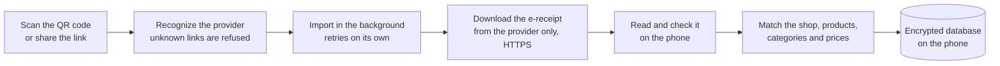
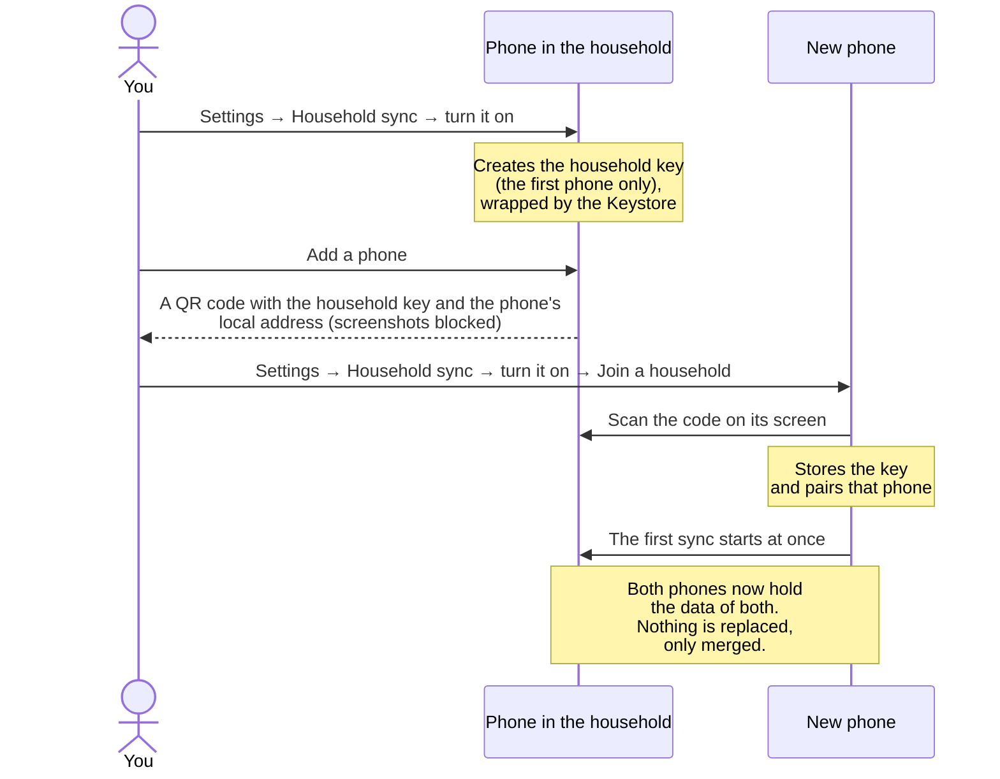
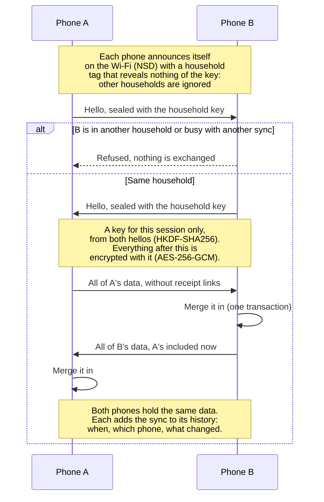

# Eksoda for Android

[](https://github.com/tsaklidis/MyEksoda/actions/workflows/ci.yml)

[](https://github.com/tsaklidis/MyEksoda/releases)

Eksoda is a standalone, privacy-first Android household expense app built around Greek e-receipts. Simply scan the QR code on a receipt, and Eksoda downloads the official e-receipt data directly from the issuing company. It tracks your spending, itemized product costs over time, and price comparisons across merchants.

**[⬇️ Download the latest APK](https://github.com/tsaklidis/MyEksoda/releases/latest)** · [How to install](#-install)

## 📸 Screenshots

<table>
  <tr>
    <td align="center"><br><sub>Home</sub></td>
    <td align="center"><br><sub>Stats</sub></td>
    <td align="center"><br><sub>Stats detail</sub></td>
    <td align="center"><br><sub>Insights</sub></td>
  </tr>
</table>

## 📱 Features

**Receipts**
- **Scan or share:** scan the receipt's QR code (zxing-cpp), or share a receipt link to Eksoda
  from any app. Imports run in the background, retry on their own, and can notify you when done.
- **Every line, not just the total:** products, quantities, package sizes, discounts and fees
  are parsed and classified on the phone.
- **Find any receipt:** filter by date, shop, store, category or product.

**Spending insights**
- **Any period:** today, this week, this month, last month, 3 months, this year, or your own
  dates, compared with the period before.
- **Month pace:** this month day by day against last month.
- **By category:** a donut chart of where the money went. Tap a category to see its products
  and shops for the period; tap "Uncategorized" to sort what is left.
- **By shop, monthly trend and top products**, each on a card you can fold away.

**Budgets and goals**
- **Monthly budgets:** one for the whole month and one per category, with a warning on Home
  when one is exceeded.
- **E-payment target:** how much of the year's required card and bank spending (30% of the
  income, up to 20.000 €) the receipts in the app already cover, and how much is left per month.

**Products and prices**
- **Price history** for every product, and **where it is cheapest**, across all the shops you
  bought it at.
- **Automatic categories** for products and shops, which you can change at any time.

**Household sync**
- **Share one household's receipts across phones,** directly over the same Wi-Fi: no server,
  no account. Off by default; pair phones once with a QR code.
- Receipts, products, categories, shops, budgets and settings sync automatically while the app
  is open, or with **Sync now**, and every sync is listed in the sync history.
- Receipt links never leave the phone that scanned them.

**Your data**
- **Encrypted backups** you can export and restore, and open on a computer with
  [`decrypt_bu.py`](decrypt_bu.py).
- **Greek and English.**

## 🔒 Privacy First

- **Your receipts never leave your phones.** There is no backend server and no user account.
- **Direct-only network access:** The app connects exclusively to registered receipt provider hosts via HTTPS (system CAs only), and, only if you turn household sync on, to your household's phones on the same Wi-Fi.
- **Household sync stays local:** phones pair by QR code and share a household key; each sync is encrypted (AES-256-GCM, with a key per session derived by HKDF-SHA256), only private local-network addresses are contacted, and receipt links stay on the phone that scanned them.
- **Encrypted storage:** All data is stored locally in an encrypted Room database (SQLCipher) secured by an Android Keystore wrapping key.
- **Zero telemetry:** No Firebase, no analytics, no crash reporting SDKs, no tracking.
- **Passphrase-protected backups:** Local backup files are encrypted using AES-256-GCM with PBKDF2-HMAC-SHA256 key derivation.
- **Independent Recovery:** Includes [`decrypt_bu.py`](decrypt_bu.py), a Python utility to decrypt and inspect backup files independently of the Android app, ensuring your data is never locked in.

## ⚙️ How it works

### Getting a receipt

The phone fetches the receipt from the company that issued it and reads it itself. Nothing
passes through a server of ours, because there is none.



### Joining a household

Done once per phone. Every phone that holds the household key is a member, and any member can
add the next phone.



**Leave household sync** forgets the key and the paired phones on that phone. Its data and its
sync history stay. Turning the switch off only pauses sync: turning it on again resumes it.

### Syncing receipts between phones

While the app is open and sync is on, phones on the same Wi-Fi find each other and sync on
their own (each pair at most every 15 minutes), or when you tap **Sync now**.



How two copies become one:

- **The same receipt scanned on both phones** is recognized (by its official mark or issuer
  and number) and kept once. The same goes for shops, stores, products and categories.
- **An edit on both phones:** the later edit wins.
- **A deletion** wins over an older copy, so a deleted receipt does not come back from the
  other phone.
- **Receipt links stay on the phone that scanned them.** A receipt from another phone says so
  and has no "Open original".
- Syncing in any order, with any phone, gives every phone the same result.

The details (protocol, merge rules, limits) are in
[`docs/design/household-sync.md`](docs/design/household-sync.md).

## 📲 Install

Eksoda is not on Google Play: each version is published as an APK on the
[Releases](https://github.com/tsaklidis/MyEksoda/releases) page. It needs Android 8.0 or newer.

1. On your phone, open the [Releases](https://github.com/tsaklidis/MyEksoda/releases) page and,
   under **Assets** of the newest release, tap `eksoda-<version>.apk` to download it.
2. Open the downloaded file (from the download notification or the Files app).
3. If Android asks, allow your browser or Files app to **install unknown apps**, then go back
   and tap **Install**.
4. Google Play Protect may warn that the app is from an unknown developer, because it does not
   come from Google Play. Tap **More details → Install anyway**.

**Updating:** install the newer APK the same way, over the installed app. Your data is kept.
Do not uninstall first: your receipts exist only on your phone, and uninstalling deletes them.
Export a backup now and then (**Settings → Export data**) to be safe.

**Verifying (optional):** each release lists the APK's SHA-256 checksum and the signing
certificate. Every release is signed with the same key (certificate SHA-256
`D3:72:B3:59:A9:53:5D:8D:70:D0:06:0C:BC:03:6C:02:EB:82:E5:19:B9:17:35:A1:D3:3B:1A:8F:8B:DB:5E:CB`),
which you can check with `apksigner verify --print-certs eksoda-<version>.apk`.

> Tip: [Obtainium](https://github.com/ImranR98/Obtainium) can watch this repository's releases
> and update the app for you.

---

## 🛠️ Technology Stack

- **Language:** Kotlin 2.4.21
- **UI:** Jetpack Compose & Material 3
- **Architecture:** Clean Architecture (`core:engine`, `core:database`, `core:data`, `core:model`, `core:ui`, feature modules)
- **Database:** Room with SQLCipher encryption
- **Dependency Injection:** Hilt
- **Background Processing:** WorkManager (for robust import scheduling & retries)
- **Networking:** OkHttp (`SafeFetcher` with host allowlist and public DNS); household sync over plain TCP on the local network, found with Android's NSD (mDNS)
- **Scanning:** zxing-cpp (reading QR codes), ZXing core (drawing the pairing QR code)
- **Android versions:** minimum API 26 (Android 8.0), target API 36, compile SDK 37

## 🏗️ Building & Testing

The project uses Gradle with convention plugins and a Makefile for quality checks:

```bash
make check           # Runs lint, ktlint, typed detekt, tests, Kover coverage, and no-telemetry checks
make test            # Runs unit tests
make build           # Builds debug APK
make codemap         # Regenerates documentation symbols map
make install_rc      # Build the release APK and install it on one device (DEVICE=<serial> if several)
make bump            # On a PR branch: bump the version (BUMP=patch|minor|major), add its changelog section
make publish         # After merging to master: check, build the signed APK, tag and publish the release
make release_key     # Once per machine: create the release signing key in ~/.eksoda
```

### Releasing

Every merge to master is a release:

1. On the pull request's branch, `make bump BUMP=minor` (patch by default) raises the version in
   `version.properties` and adds a section for it to [`CHANGELOG.md`](CHANGELOG.md). Replace its
   TODO line with the release notes and commit both files with the pull request.
2. Merge the pull request.
3. `make publish` runs the checks, builds the APK signed with the release key, tags master
   `v<version>` and creates the GitHub release with the changelog section and the checksums as
   its notes. It needs `gh` logged in with an account that can push to the repository.

## 📦 Backup Recovery (`decrypt_bu.py`)

If you have an Eksoda backup file (`.eksoda`) and cannot access the Android app, you can decrypt and inspect your backup data independently using the Python recovery script:

```bash
pip install cryptography
python3 decrypt_bu.py your_backup.eksoda [output_archive.zip]
```

## Documentation

| Document | Description |
|---|---|
| [`docs/codemap/OVERVIEW.md`](docs/codemap/OVERVIEW.md) | Architecture, modules, import pipeline, data layer, backup, and rules |
| [`docs/design/household-sync.md`](docs/design/household-sync.md) | Household sync: pairing, protocol, merge rules |
| [`CHANGELOG.md`](CHANGELOG.md) | What changed in each release |

## License

Copyright (C) 2026 Stefanos I. Tsaklidis

Eksoda is free software: you can redistribute it and/or modify it under the terms of the
[GNU General Public License](LICENSE) as published by the Free Software Foundation, either
version 3 of the License, or (at your option) any later version. It is distributed in the hope
that it will be useful, but WITHOUT ANY WARRANTY; without even the implied warranty of
MERCHANTABILITY or FITNESS FOR A PARTICULAR PURPOSE.

In short: you may use, change and share the code, but any app you publish from it must also be
open source under the GPL, with its full source code. The name "Eksoda" and the logo are not
licensed: a fork needs its own name, icon and application id. See [TRADEMARKS.md](TRADEMARKS.md).

Releases up to 0.1.1 were published under the MIT License.
